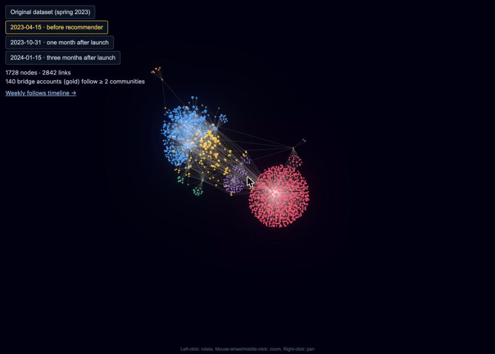
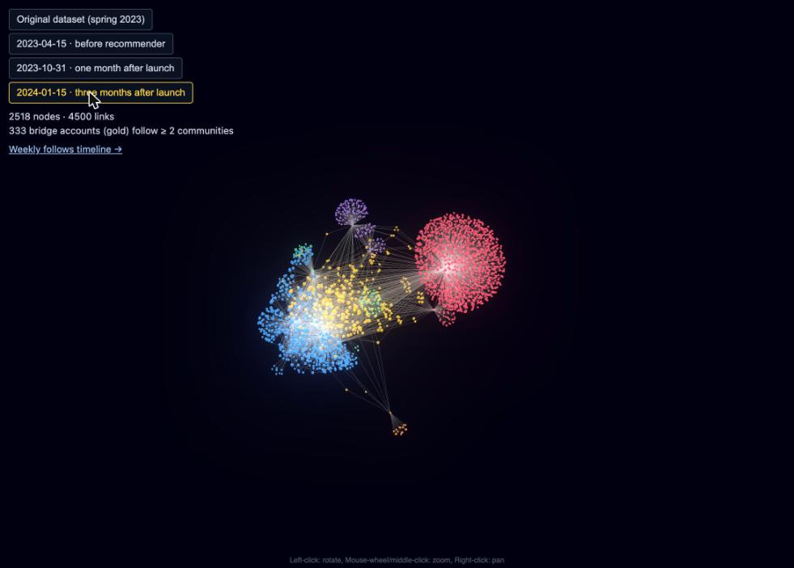
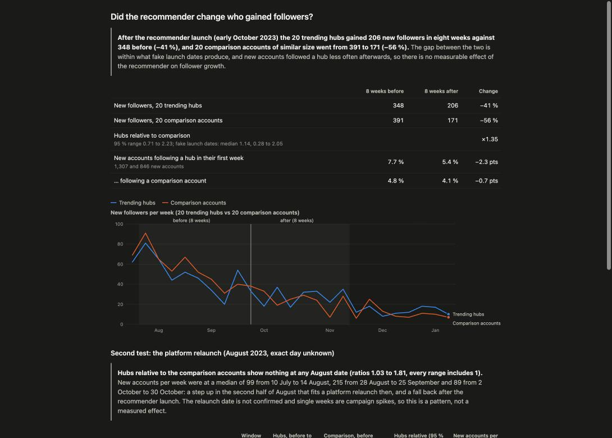
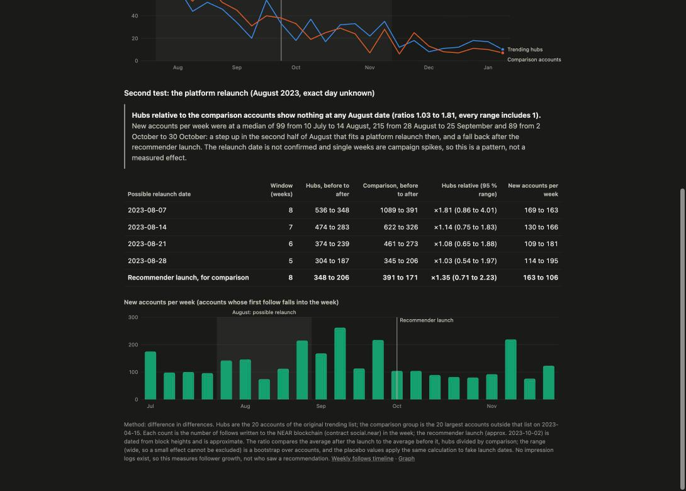

# NEAR Social: trending users before and after the recommender

An interactive 3D map of the [NEAR Social](https://near.social) follow network around its "trending users",
rebuilt from the public blockchain at three points in time, plus a weekly timeline of how the network grew.

- Graph: https://near-recommender-poc-trending-users-viz.vercel.app/
- Timeline: https://near-recommender-poc-trending-users-viz.vercel.app/timeline.html

| 2023-04-15, before the recommender | 2024-01-15, after the recommender |
|---|---|
|  |  |

Each dot is an account, each line a follow. Colors are communities, big dots are the 20 hub accounts (sized by
HITS authority), and gold dots are *bridge accounts* that follow hubs of two or more communities.

## Background

NEAR Social was a social network whose posts, likes and follows were written to the NEAR blockchain (contract
`social.near`). In spring 2023 a team of three built a recommender for it as the capstone project of the Constructor
Data Science Bootcamp (batch 03/2023), in collaboration with Pagoda, the company behind the NEAR Blockchain Operating
System. That bootcamp code is in [scopalaffairs/near_recommender](https://github.com/scopalaffairs/near_recommender)
(archived). It had four parts: top trending users, friends of friends, tag similarity and post similarity. Each team
member owned one method; the author's was the HITS-based one, and the friends-of-friends part was never finished.

The problem the trending-users part addressed: the network had a few large, mostly isolated clusters. The clearest
one was a "mushroom" of accounts that had joined through the Aurora network and followed only the Aurora news
account. These clusters did not know each other or the core userbase around `root.near` and `mob.near`. The
recommender suggested trending users from a *different* community than the user's own, so that clusters would meet.

According to the project author, the timeline was: research in spring 2023 (Google Colab, later Databricks). After the
bootcamp the author was hired as a freelancer and worked on it full-time from September 2023, improved all three
methods and handed over the complete package. The author kept no copy of that final code, so the bootcamp repository
is the only code that survives. The recommender went live
in early October 2023. The near.org platform, a new interface that replaced the dated
near.social front end in August 2023, was shut down in March 2024.

This repository is not that launched system. It rebuilds the network data around it from the public chain, and it
replays the ideas of the bootcamp code (below).

### How `trending_users.json` was made originally

Taken from the bootcamp code (`src/models/trending_users.py`, `src/data/queries/query_user_metrics.py`); the launched
version improved on it, so details may differ:

1. Follow edges come from the parsed `social.near` transactions (`graph_follows`).
2. Communities: Louvain community detection on the undirected follow graph (cdlib, resolution 1).
3. Per user, over the last 30 days: *engagement* = comments + likers + followers, *activity* = posts + likes +
   followings, each weighted 1 / 0.5 / 0.1.
4. `trending_metric = weighted engagement / weighted activity`. The top 20 users are the trending users.

`trending_users.json` is consistent with this: 20 hub accounts (the group IDs are community IDs) plus 1,676 followers
of those hubs, with the edges between them. It is the original, unchanged dataset from spring 2023 and is the first
entry in the graph's switcher.

## What this repository adds

The pipeline that produced the original data is lost, and the recommender had no control group. So the data was
rebuilt from the chain itself:

1. **Snapshots** of the whole follow graph on 2023-04-15, 2023-10-31 and 2024-01-15 (`data/raw/`), read from an
   archival NEAR RPC node at fixed block heights.
2. **A fixed cohort**: the 20 hubs of the original file, held constant over all snapshots, so before and after
   compare the same accounts. Their followers are the leaves.
3. **HITS scores** (hub and authority) for every account and **bridge accounts** per snapshot (`data/trending_users_*.json`).
4. **A weekly timeline** of new follows into the cohort and of bridge events, from the block height at which each
   follow was written (`data/timeline.json`).

How well does it reproduce the original? On 2023-04-15, 96 % of the original nodes and 93 % of its edges match
(the rest are accounts that unfollowed, and accounts that followed afterwards). Louvain communities on the 2023-04-15
graph put the Aurora hubs together, the JumpDeFi/Neko hubs together and most root-userbase hubs together,
as the original groups do; the small NDC/Mintbase and NEARxART groups merge differently. Louvain is not
deterministic, and the original ran on a different data base, so exact IDs differ.

## What the data shows

Descriptive only. There was no control group, so none of this proves or disproves an effect of the recommender.

| | 2023-04-15 | 2023-10-31 | 2024-01-15 |
|---|---|---|---|
| nodes in the cohort graph | 1,728 | 2,422 | 2,518 |
| bridge accounts (follow ≥ 2 communities) | 140 (8.2 %) | 314 (13.1 %) | 333 (13.3 %) |

- **Most clusters merged before the recommender existed.** The bridge share rose from 8.2 % in April to 13.1 % at
  the end of October 2023 and was 13.3 % in January 2024. In the weekly series, 158 of the 195 new bridge events after
  2023-04-17 happened before the launch (6.6 per week, against 2.6 per week afterwards).
- **Growth peaked in spring 2023 and faded.** The weekly new follows into the hubs peaked at 408 in the week of
  2023-02-27 (the Aurora campaign) and were at 20 to 50 per week by autumn.
- **No lasting bump at the launch.** In the eight weeks before the launch the hubs gained 42.6 new follows per week
  on average, in the eight weeks after 25.1. New bridge events: 5.6 versus 4.0 per week. There is a one-week rise in
  the week of 2023-10-09 (37 new follows after 14 the week before, 6 bridge events after 2), but it is gone the week
  after and no larger than swings before the launch (53 in the week of 2023-09-18).
- **Conversion did not rise.** Of the accounts that followed only Aurora hubs, 0.45 % per month later followed another
  community between April and the launch (26 of 1,042 accounts), and 0.28 % per month after it (13 of 1,330).
- **The Aurora cluster stayed a mushroom.** 92 % of its followers followed no other community in April 2023, 88 % in
  January 2024.
- **Almost nobody unfollowed.** Less than 0.3 % of follow edges disappeared between snapshots. Writing to the chain
  cost money, which plausibly kept casual activity down.

## Did the recommender change who gained followers?

After the recommender launch (early October 2023) the 20 trending hubs gained 206 new followers in eight weeks against
348 before (-41 %), and 20 comparison accounts of similar size fell more (-56 %, from 391 to 171). The hubs held up
somewhat better, but that gap (ratio 1.35, range 0.71 to 2.23) is within what fake launch dates produce, and new
accounts followed a hub less often afterwards (7.7 % against 5.4 %), so there is no measurable effect of the
recommender on follower growth; a small effect cannot be excluded.

The comparison group is the 20 largest accounts outside the hub list on 2023-04-15, which the trending rule would not
have pushed. Details, table and method are on [impact.html](impact.html); the calculation is `pipeline/impact.py`
(difference in differences with a bootstrap over accounts and placebo launch dates). There are no impression logs, so
this measures follower growth, not who saw a recommendation.

### Second test: the interface relaunch (near.org)

The same hub-against-comparison test at any Monday in August 2023 shows nothing (ratios 1.03 to 1.81, every 95 % range
includes 1), but new accounts per week stepped up in the second half of August (median 99 per week from 10 July to
14 August, 215 from 28 August to 25 September) and fell back after the recommender launch (89 per week in October).
That fits a relaunch of the interface in late August, but the exact day is not confirmed (see the limitations), single weeks
are campaign spikes, and a pattern in the same data that was used to look for it is not a measured effect.

## Replaying the bootcamp recommender ideas

How well would the ideas of the bootcamp repository have predicted the follows that really happened? This is not a
test of the launched system, which improved all three methods. For a time
window, the graph at the start is rebuilt, every method recommends accounts per user, and a user counts as a hit if
at least one recommended account was followed within the window (`pipeline/evaluate.py`, results in
`data/evaluation.json`). Users are existing accounts that made a new follow in the window (641 before the launch, 845
after). The windows differ in length (2023-04-26 to 2023-10-02 versus 2023-10-02 to 2024-01-15), so compare methods
within a window, not rates across windows.

| Hit rate, 5 recommendations per user | before launch | after launch |
|---|---|---|
| friends of friends (2-hop) | 30.7 % | 17.2 % |
| HITS authority | 29.0 % | 12.3 % |
| most followed (popularity) | 27.8 % | 10.7 % |
| trending hubs outside the user's community | 11.2 % | 4.1 % |
| random accounts | 2.2 % | 0.3 % |

The saved recommendations of the bootcamp repository (`matrix_intersection_05.json`, 15 per user, committed
2023-04-26; here `data/raw/stored_recommendations_2023-04-26.json`) were tested on the 614 of their users that made a
new follow before the launch: 24.4 % hit with all 15 and 17.6 % with the top 5. Plain popularity reaches 37.8 % and
27.4 % for the same users. The lists were hardly personalized: `gilberth.near` was in 3,495 of the 3,499 lists.

For accounts that appear for the first time in the window, which is the case the bootcamp rule handled with trending
users (accounts younger than 7 days):

| | before launch | after launch |
|---|---|---|
| new accounts in the window | 3,364 | 1,818 |
| follow at least one of the 20 hubs | 17.2 % | 5.6 % |
| follow hubs of two or more communities | 2.4 % | 0.4 % |
| top-5 most followed accounts would hit | 14.7 % | 4.1 % |
| 5 random hubs would hit | 5.7 % | 1.7 % |

What this says: suggesting accounts from another community is the mixing idea of the project, and it is exactly what
users are least likely to follow on their own (11.2 % against 30.7 % for friends of friends).

Limits of this test: it measures agreement with organic follows, not whether users saw or acted on a suggestion
(there are no impression logs). The trending list is the April 2023 cohort, not a list recomputed at launch. Friends
of friends is the classic 2-hop count here. In the bootcamp code it was an unfinished XGBoost experiment whose call is
commented out in `recommender.py`, so the number shows what the idea can do, not what the bootcamp code did.

## Limitations

- **No control group, no causal claim.** Between April 2023 and January 2024 there were also the near.org relaunch,
  NEARCon and general network growth and decline. The launch date is approximate (early October 2023).
- **The cohort is fixed on purpose**, so it cannot show clusters that appeared later. `data/metrics.json` lists
  isolated clusters per snapshot, e.g. `creativesdao.sputnik-dao.near`, `nearchinese.near` and `nearinturkiye.near`
  in October 2023.
- **The original hub selection is not recomputed.** The trending metric needs the history of posts, likes and
  comments. SocialDB keeps only the latest value per key, so this history is not available from archival state and
  would need transaction data (for example NEAR Lake or the public BigQuery dataset).
- **Only follow edges still present are seen.** The account list comes from today's follow keys
  (`api.near.social`), so accounts that have since removed every follow are missing.
- **"Launch" always means the recommender**, dated approximately to early October 2023. The relaunch of the
  platform's interface (near.org, a new front end replacing near.social in August 2023, per the author) is a separate
  event and gets its own test; both show the same `social.near` data, so the chain data is continuous across it. The
  eight weeks before the recommender launch (from 2023-08-07) overlap the weeks after that relaunch. No public source
  for the exact relaunch day was found, so the second test runs for every Monday in August. (The Blockchain Operating
  System, the technology under near.org, was announced earlier, in March 2023, see
  [The Paypers, 2023-03-06](https://thepaypers.com/cryptocurrencies/near-launches-the-blockchain-operating-system--1261648);
  that is a different event.)
- **Block heights to dates** are interpolated between blocks with exactly known timestamps (error of a few days).

## Repository layout

| Path | Content |
|---|---|
| `index.html` | 3D graph (three.js via 3d-force-graph, all CDN versions pinned) with a snapshot switcher |
| `impact.html` | did the recommender (and the platform relaunch) change who gained followers: tables, charts, short summaries |
| `timeline.html` | weekly follows and bridge events, plain SVG, light and dark theme, table view |
| `trending_users.json` | the original dataset from spring 2023 |
| `data/raw/follows_<date>.json` | follow graph snapshots: `{block, label, follows: {account: [followed, ...]}}` |
| `data/trending_users_<date>.json` | cohort graph per snapshot (nodes carry HITS `auth` / `hub`, and `bridge`) |
| `data/metrics.json` | mixing metrics and isolated clusters per snapshot |
| `data/timeline.json`, `data/edges_bh_2024-01-15.json` | weekly series and the follow creation block heights behind it |
| `data/raw/stored_recommendations_2023-04-26.json` | the saved recommendations of the bootcamp repository (account to 15 accounts, best first) |
| `data/evaluation.json` | hold-out results of the recommendation replay |
| `data/impact.json` | weekly new followers of hubs and comparison accounts, and the difference-in-differences summary |
| `pipeline/` | the scripts, see [pipeline/README.md](pipeline/README.md) |

To run it locally: `python3 -m http.server`, then open http://localhost:8000. To regenerate the derived data from the
snapshots: `python3 pipeline/cascade.py`, `python3 pipeline/timeline.py` and `python3 pipeline/evaluate.py` and `python3 pipeline/impact.py` (needs numpy).

## License

GPL-3.0, like the original [near_recommender](https://github.com/scopalaffairs/near_recommender). See [LICENSE](LICENSE).
